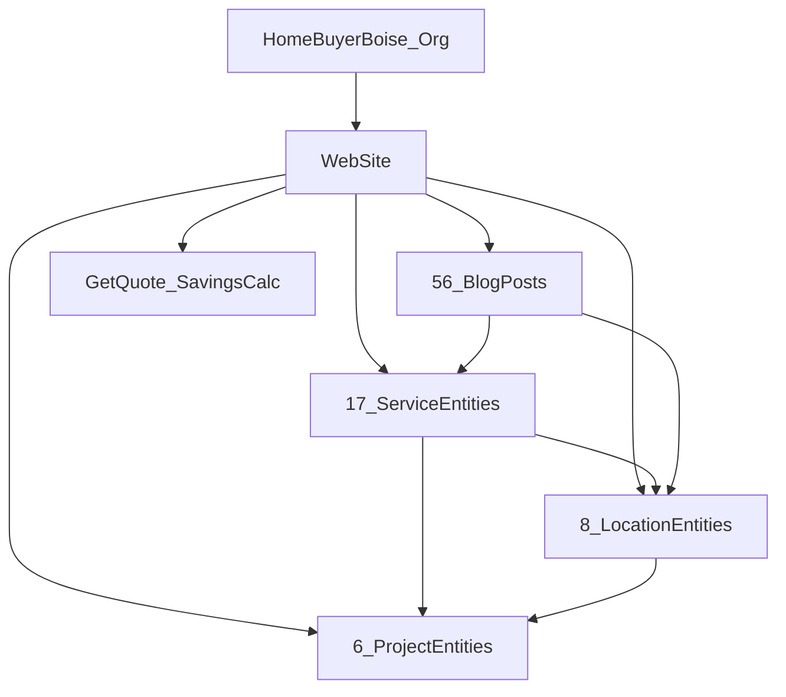

# Content Knowledge Graph

## Entity Relationships

| From | To | Relationship |
|------|-----|--------------|
| Organization | 17 Services | offers / hasOfferCatalog |
| Organization | 8 Locations | areaServed |
| Service | Location | service×city pages (136) |
| Project | Service | case study proof |
| Project | Location | geographic authority |
| Blog | Service/Location | topical support + internal links |

## Source of Truth

- `shared/entityGraph.ts` — programmatic entity registry
- `lib/schema.ts` — JSON-LD `@id` graph
- `shared/serviceCityMatrix/` — service×location content clusters
